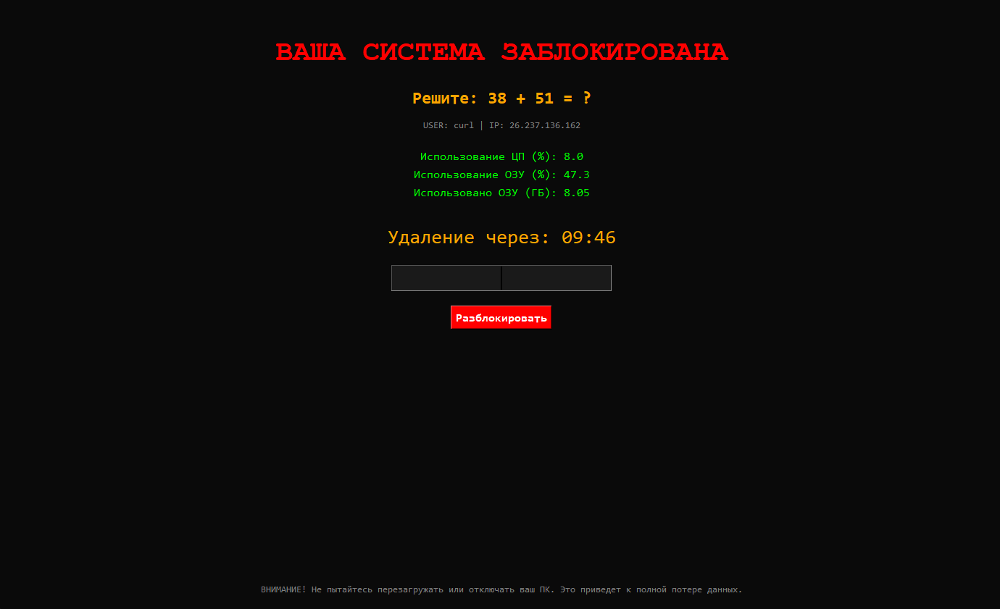

<div align="center">

# 🏴‍☠️ Winlocker Simulation

**Учебный симулятор программы-вымогателя.** Создан в образовательных целях
в рамках индивидуального проекта.



</div>


---

## 🔑 Особенности

- **Math Unlock** — динамическая генерация математических примеров
  (`a + b`, `a − b`, числа 10–99) для разблокировки экрана.
- **Full Screen UI** — полноэкранное перекрытие окон поверх всего, кастомный
  курсор, мигающий заголовок, обратный отсчёт 10 минут.
- **Anti-Close** — блокировка системных сочетаний клавиш, закрытия окна
  (`WM_DELETE_WINDOW`) и Диспетчера задач через реестр.
- **Persistence** — запись в ветку автозапуска `Run`, чтобы симулировать
  поведение настоящих программ-вымогателей.
- **Privilege Escalation** — перезапуск с запросом прав администратора
  через `ShellExecuteW` с флагом `runas`.
- **System Monitor** — отображение загрузки CPU/RAM в реальном времени
  через `psutil`, обновление раз в секунду.
- **Audio Background** — заготовка фонового звука: **путь к файлу не задан**,
  функция `play_sound()` вызывается в отдельном процессе.

## 🛠 Использованные библиотеки

| Библиотека | Зачем |
|---|---|
| `tkinter` | GUI, полноэкранное окно |
| `ctypes` | вызов Win32 API, проверка прав администратора, перезапуск |
| `winreg` | работа с реестром: Диспетчер задач и автозапуск |
| `keyboard` | глобальный хук клавиатуры |
| `psutil` | мониторинг CPU/RAM и запуск звука в отдельном процессе |
| `playsound` | воспроизведение аудио |


## 📁 Структура

```
Winlocker/
├── main.py          # логика и интерфейс
├── requirements.txt # неободимые версии библиотек 
├── image.png        # скриншот
└── sound.mp3        # Воспроизведение звука
```

---

<div align="center">
  <sub>Только для образовательных целей.</sub>
</div>
